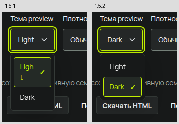

# Визуальная проверка UI KIT — 2026-11-01

Проверка выполнялась для HTML/PHP-поставки 1.5.2 в изолированном Chrome/Linux,
с локальными ресурсами и отдельным временным профилем. Исправления относятся к общим
компонентам и копируемым примерам. Исходные референсы, vendored файлы и лицензии сохранены.

| Обнаружено | Исправлено |
|---|---|
| Light, 10/20, фильтры и названия экранов дробятся в узких меню | Ширина меню учитывает все пункты, padding и галочку; ограничена viewport, позиция учитывает итоговую высоту |
| Выбранный select обрезает короткую фразу в контейнере 240 px | Значение переносится по строкам, control растёт по высоте |
| Числа и подписи вкладок сливаются после копирования | Метрики используют общий stack, текстовые роли и интервалы |
| Палитра теряет образцы цветов, отступов и скруглений | Переносимые foundation-классы входят в ui-kit.css |
| Семантические swatches соответствуют теме каталога, а не preview | Настройки source передаются в генератор палитры |
| Типографика теряет компоновку; ввод и сброс не работают в копии | Общие стили specimen, обработчики ввода и сброса с возвратом фокуса |
| Длинный заголовок палитры выходит за узкий контейнер | Заголовки копий используют существующую текстовую роль с переносом |
| Timeline и контакты сохраняют desktop-колонки внутри узкой области | Добавлены container queries для brand-responsive и минимумы колонок |
| Образцы графики перекрывают соседние подписи | Сетка определяет число колонок по доступной ширине |
| Сообщение пустой таблицы центрируется вне видимой области на телефоне | Пустая таблица использует ширину контейнера и скрывает ненужную строку заголовков |
| Группа undo/redo выходит из узкой поверхности | Связанные действия используют brand-cluster с естественным переносом |



Сравнения narrow-геометрии: [timeline](audits/2026-11-01/timeline-comparison.png),
[контакты](audits/2026-11-01/contact-comparison.png),
[графика](audits/2026-11-01/graphics-comparison.png).
[Метаданные проверки](audits/2026-11-01/evidence.json).

## Покрытие

| Набор наблюдений | Сочетаний |
|---|---:|
| Все 86 записей × light/dark × default/compact × 320/390/768/1440 px | 1 376 |
| Все 39 дополнительных применимых состояний × те же 16 отображений | 624 |
| 73 записи с container mode × 240/320 px внутри 1440 px × темы/плотности, длинный текст | 584 |
| Все 15 автономных HTML и 21 раздел каталога × 16 отображений | 576 |
| Открытые message/confirm/form/drawer/popover/tooltip/gallery/toasts/choice × 16 отображений | 144 |

На итоговых проходах этих 3 304 сочетаний нет непредусмотренных переполнений
документа, выхода содержимого/текста за границы проверяемой области или лишнего
дробления короткого текста в меню. Стресс-палитра повторно проверена после последнего
исправления заголовка; её восемь случаев заменяют прежние результаты, а не прибавляются
к числу уникальных сочетаний. Таблицы и мобильные tabs сохраняют свои scroll-области;
fixed-уведомления оцениваются относительно viewport.
Дополнительный сеансовый проход overlays завершён: 144/144 открываются и видны,
без непредусмотренной прокрутки документа или перекрытия backdrop. Перед click
проверка прокручивает trigger в viewport; неинтерактивный tooltip оценивается по
видимой геометрии, поскольку его pointer-events намеренно выключены.

Для визуального просмотра сохранены полные PNG обычных и стресс-состояний,
обзорные листы desktop/mobile и отдельные финальные снимки всех исправленных примеров.
Геометрический проход проверяет все сочетания; ручной просмотр обзорных листов и
конкретных дефектов не является индивидуальной экспертной приёмкой каждого пикселя.

Обязательная команда `UIKIT_FIREFOX=/usr/bin/firefox python3 scripts/release.py`
прошла: **951 Chrome + 90 Firefox**, 86 копируемых документов, 168 маршрутных
сочетаний базового набора, 0 JavaScript exceptions. Новые 117 assertions геометрии
входят в общий verify, ещё восемь Firefox assertions проверяют текст открытых меню.
Все 16 существующих visual baseline совпали с отличием 0.000%; эталоны не изменялись.
Проверки включают keyboard/focus, значения/FormData, loading/error/empty/selected,
validation, retry, lifecycle, scoped cleanup, reflow, forced colors, reduced motion
и работу через file://.

## Воспроизведение

```sh
node scripts/audit-visual.mjs --capture
node scripts/audit-visual.mjs --stress --capture
node tests/geometry.mjs
UIKIT_FIREFOX=/usr/bin/firefox python3 scripts/release.py
```

JSON и PNG записываются в ignored test-results/visual-audit, отчёт обязательных
проверок — test-results/verification.json. `--capture` не обновляет baseline.
Скрипт наблюдений не заменяет обязательные assertions и сообщает найденные случаи
в JSON. Нужны только имеющиеся Node/Python/Chrome; новые runtime-зависимости не добавлены.

Это проверка доступных desktop-движков и эмуляции размеров/coarse pointer.
Safari, реальные iOS/Android, экранная клавиатура телефона и screen reader не были
доступны; [границы поддержки](support.md) сохраняются. Неограниченное количество
проектных данных, расширений браузера и устройств не объявляется проверенным.
